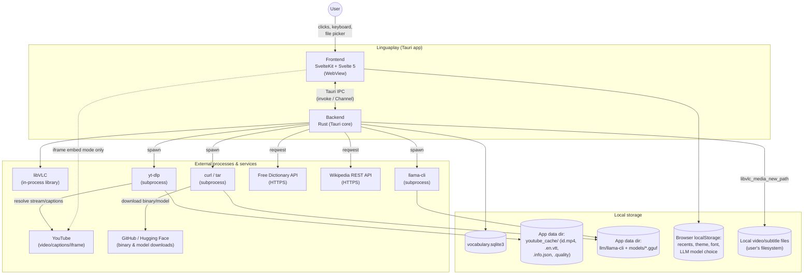
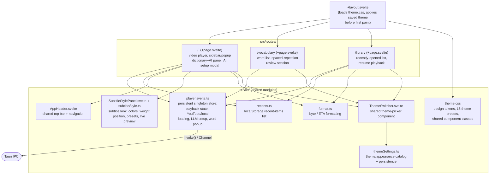
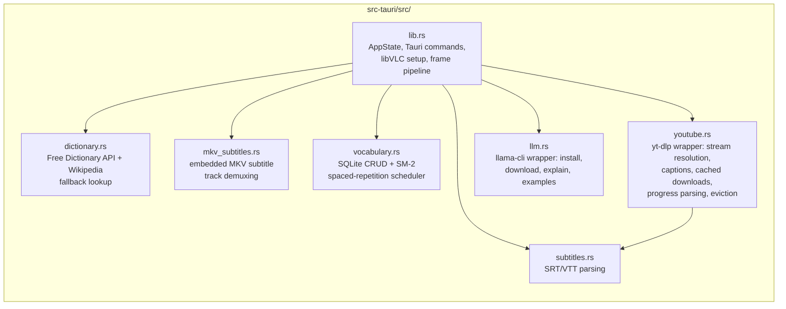
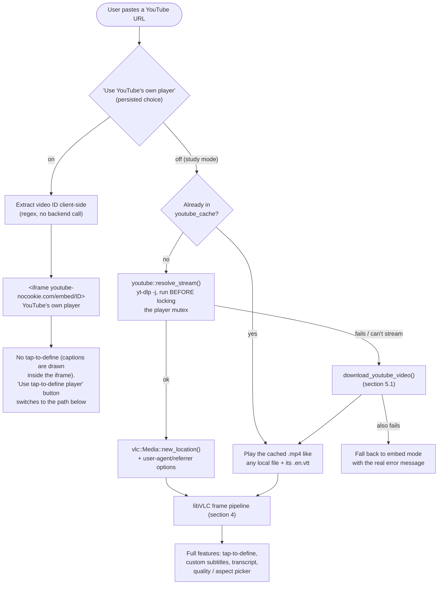
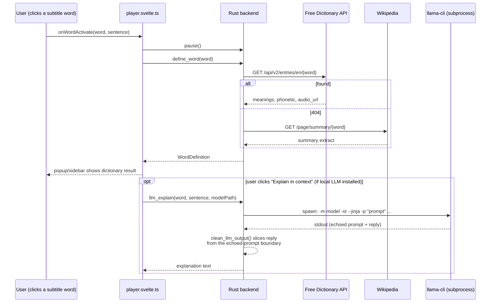
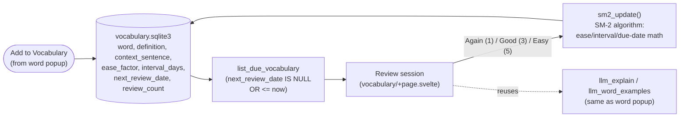
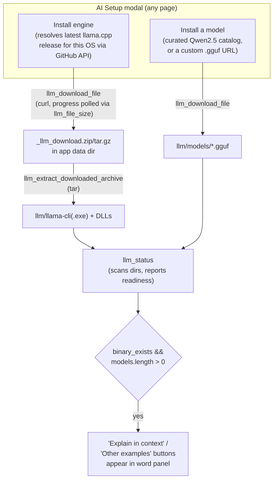
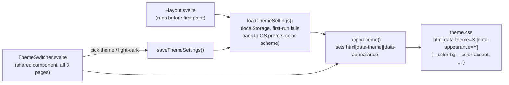

# Linguaplay — Architecture

Linguaplay is a Tauri 2 desktop app: a SvelteKit/Svelte 5 frontend (TypeScript,
compiled to static assets, `ssr=false`) driving a Rust backend over Tauri's IPC
bridge. The backend wraps libVLC for playback and shells out to a few
external tools (`yt-dlp` with `ffmpeg`, `llama-cli`, `curl`, `tar`) for features libVLC and
the JS runtime can't do alone.

## 1. System context



**Three ways a YouTube link can play** (details in section 5): a direct
stream resolved by `yt-dlp` and decoded through libVLC; a full download into
the app-data cache when streaming is blocked; or "embed mode", which drops
YouTube's own `<iframe>` player into the page. Only the first two give
click-to-define and custom subtitles, because only they put the frames and
captions under the app's control.

## 2. Frontend structure



`player.svelte.ts` is a **module-level singleton** (not component state), so
it survives SvelteKit's destroy/recreate cycle when navigating between
routes — video playback, controls, and LLM state stay alive whether you're
looking at the player, the vocabulary list, or the library.

## 3. Backend module structure



### Registered Tauri commands (by feature area)

| Area | Commands |
|---|---|
| Local file playback | `load_file`, `load_subtitles`, `list_embedded_subtitle_tracks`, `load_embedded_subtitle_track` |
| YouTube (stream) | `load_youtube`, `list_youtube_captions`, `load_youtube_caption` |
| YouTube downloads | `download_youtube_video` (with a progress `Channel`), `list_youtube_downloads`, `delete_youtube_download`, `clear_youtube_downloads` |
| Playback control | `play`, `pause`, `toggle_play`, `seek_ms`, `set_volume`, `set_playback_rate`, `get_status`, `subscribe_video_frames` |
| Quality / aspect | `set_video_quality`, `set_aspect_ratio` |
| Dictionary | `define_word` |
| Vocabulary & review | `add_vocabulary_word`, `list_vocabulary`, `delete_vocabulary_word`, `list_due_vocabulary`, `review_vocabulary_word` |
| Local LLM | `llm::llm_status`, `llm::llm_download_file`, `llm::llm_file_size`, `llm::llm_extract_downloaded_archive`, `llm::llm_explain`, `llm::llm_word_examples` |

## 4. Video frame pipeline

Playback is not a native `<video>` element — libVLC decodes off-screen and
frames are pushed to a `<canvas>` over Tauri IPC.

```mermaid
sequenceDiagram
    participant VLC as libVLC (video_lock/unlock/display callbacks)
    participant Sink as FrameSink (Rust, shared Arc)
    participant Enc as JPEG encoder (image crate)
    participant Chan as Tauri Channel<Response>
    participant JS as player.svelte.ts
    participant Canvas as &lt;canvas&gt; (createImageBitmap)

    VLC->>Sink: raw RGBA frame (video_lock/unlock)
    Sink->>Enc: encode frame as JPEG
    Enc->>Chan: raw bytes (not JSON)
    Chan->>JS: onmessage(ArrayBuffer)
    alt previous frame still decoding
        JS-->>JS: drop frame (no backlog)
    else ready
        JS->>Canvas: createImageBitmap + drawImage
    end
```

**Subtitles are not rendered by libVLC.** Each media is opened with
`:no-sub-autodetect-file` and `:no-spu`, so libVLC neither auto-loads a
sibling `.vtt`/`.srt` nor draws embedded subtitle tracks into the frames. The
app parses the cues itself (`subtitles.rs`, `mkv_subtitles.rs`) and overlays
them in HTML so the words are clickable; without those options a downloaded
video showed two stacked captions.

On every page load the backend clears the frame channel and pauses
(`Builder::on_page_load`), so a webview reload can never leave libVLC pushing
frames to a dead channel.

Key perf notes baked into the build: `[profile.dev.package."*"] opt-level = 3`
keeps JPEG encoding fast even in `cargo build`/`tauri dev` (unoptimized
encoding was ~150ms/frame vs ~7-9ms optimized), and the frontend drops any
frame that arrives while the previous one is still decoding rather than
queuing, so a slow moment never builds a backlog.

## 5. YouTube loading — stream, download, or embed

There are three ways a YouTube link can play. The app tries the richest one
first and degrades only when it has to.



Captions for non-embed videos are fetched separately
(`list_youtube_captions` / `load_youtube_caption`), preferring manual
subtitle tracks and falling back to auto-generated ones. For a downloaded
video the English captions are saved next to the file as `<id>.en.vtt`, and
`subtitles::find_sibling` picks them up exactly like a local `.srt`.

### 5.1 Download cache, quality and progress

```mermaid
sequenceDiagram
    participant UI as player.svelte.ts
    participant Cmd as download_youtube_video (lib.rs)
    participant YT as youtube::download_video
    participant Y as yt-dlp (+ ffmpeg)
    participant Disk as youtube_cache/

    UI->>Cmd: url, video_id, quality_height, Channel
    Cmd->>Cmd: validate id; stop libVLC if the cached file<br/>is about to be replaced (Windows file lock)
    Cmd->>YT: spawn_blocking
    YT->>Disk: cache hit with same quality marker?
    alt hit
        Disk-->>YT: path (no events sent)
    else miss or different quality
        YT->>Y: H.264 video + m4a audio capped at height,<br/>--progress-template, --force-overwrites
        loop stdout lines
            Y-->>YT: VLP|downloading|bytes|total|speed|eta|vcodec|acodec
            YT-->>UI: DownloadProgress via Channel (throttled ~100 ms)
        end
        Y->>Disk: id.mp4, id.info.json, id.en.vtt
        YT->>Disk: id.quality (requested height)
    end
    YT->>Disk: evict oldest past 3 GB
    Cmd-->>UI: { path, title }
```

- **Progress:** yt-dlp's progress hook is printed in a fixed template and
  parsed in Rust. Video and audio are separate transfers (plus a merge), so
  the percentage shown is a weighted estimate across the stages, and the merge
  step is shown as indeterminate. Caption downloads report through the same
  hook and are ignored (they carry no codecs).
- **Quality:** the picker maps to a max height (Auto, 360–1080). The chosen
  height is stored in `<id>.quality`; asking for a different one re-downloads
  and replaces the file, asking for Auto reuses whatever is cached.
- **Management:** the Library lists cached downloads with their size and
  quality (`list_youtube_downloads`) and can delete one
  (`delete_youtube_download`, with a path-traversal-safe id check) or all
  (`clear_youtube_downloads`). Library entries and resume positions survive
  deleting the file; it is simply downloaded again on next open.

## 6. Word lookup & context-aware AI explanation



The same `wordPanel` UI (and the same backend commands) is reused in three
places: the player's sidebar (windowed mode), the fullscreen popup, and the
vocabulary review card's back panel.

## 7. Vocabulary & spaced repetition



A lapse (rating "Again") doesn't get scheduled days out — it's reinserted a
few cards ahead in the same session queue, mirroring how physical flashcard
drills handle a miss.

## 8. Local LLM provisioning



## 9. Theming



Theme and appearance (light/dark) are two independent, fully user-controlled
axes — picking a theme doesn't change light/dark, and neither re-syncs to the
OS after the first launch. The video player's own chrome stays permanently
dark regardless of the chosen app theme (`--player-*` tokens scoped to
`.player-card`, matching how YouTube/Netflix/VLC treat their controls as
part of the video, not the surrounding UI).

## 9.1 Subtitle styling

The on-video subtitle look is a set of independent settings in the
`player.svelte.ts` store: size, font, weight, text color, background color
and opacity, outline, and position (top / middle / bottom), plus four presets
(Default, High contrast, Yellow, Dark on light). `subtitleStyle.ts` turns them
into CSS custom properties (`--subtitle-color`, `--subtitle-bg-rgb`, ...) that
both the real overlay and the preview in `SubtitleStylePanel.svelte` use, so
the preview cannot drift from what is drawn. The outline color flips to white
for black text. Each setting is validated against its option list on load, and
an absent value means "default" (not zero).

## 10. Local storage summary

| Store | Contents | Written by |
|---|---|---|
| `vocabulary.sqlite3` (Rust/SQLite) | Vocabulary entries + SM-2 scheduling fields | `vocabulary.rs` |
| App data dir `youtube_cache/` | Downloaded YouTube videos: `<id>.mp4`, `<id>.en.vtt`, `<id>.info.json`, `<id>.quality` (3 GB cap, oldest evicted first) | `youtube.rs` (via `yt-dlp`) |
| App data dir `llm/` | `llama-cli` binary + `models/*.gguf` | `llm.rs` (via `curl`/`tar`) |
| `localStorage: videoLearnRecents` | Recently opened local files/YouTube links, resume position | `recents.ts` |
| `localStorage: videoLearnTheme` | Selected theme id + appearance | `themeSettings.ts` |
| `localStorage: llmModelPath`, `playbackRate`, `videoLearnPauseAfterLine` | Active LLM model, playback speed, pause-after-line toggle | `player.svelte.ts` |
| `localStorage: subtitle*` | Subtitle size, font, weight, colors, background opacity, outline, position | `player.svelte.ts` |
| `localStorage: youtubeDownloadQualityHeight`, `videoLearnYoutubeEmbedMode` | Download quality choice; "use YouTube's own player" | `player.svelte.ts` |
