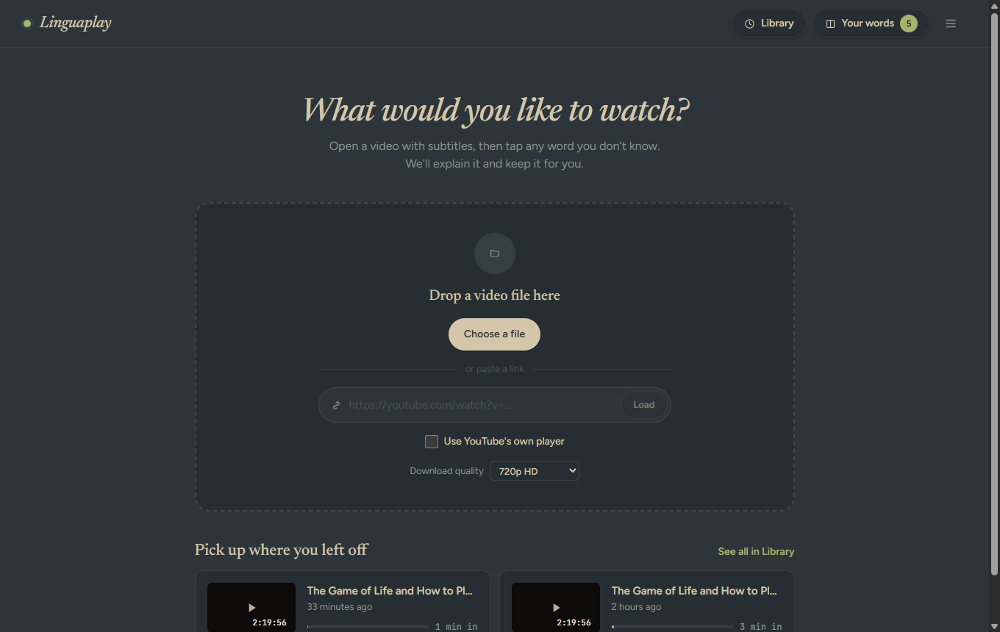
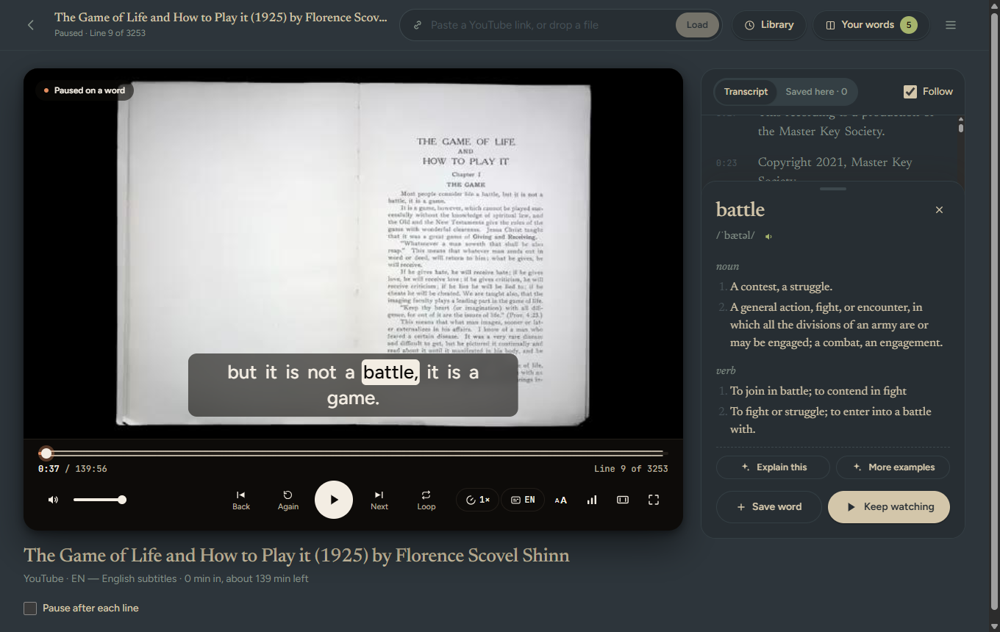
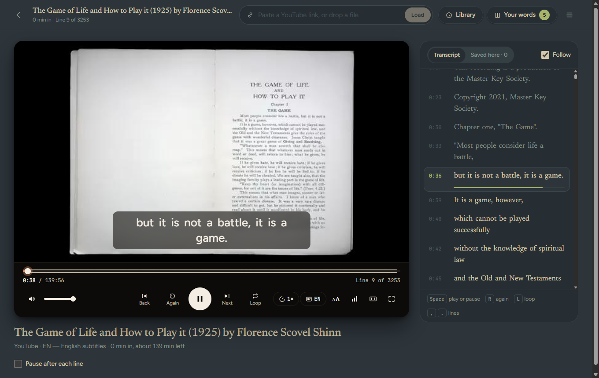
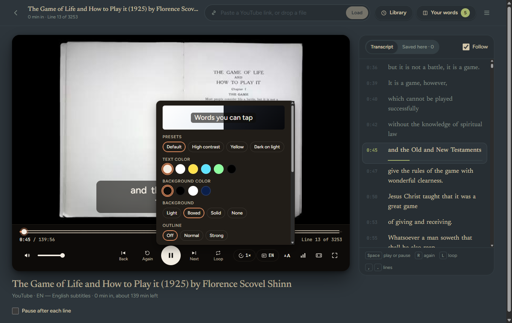
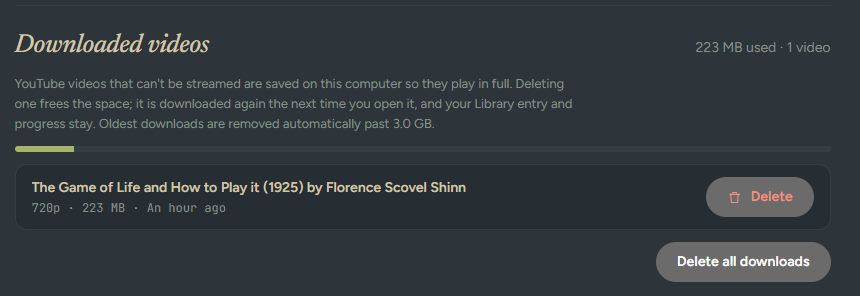
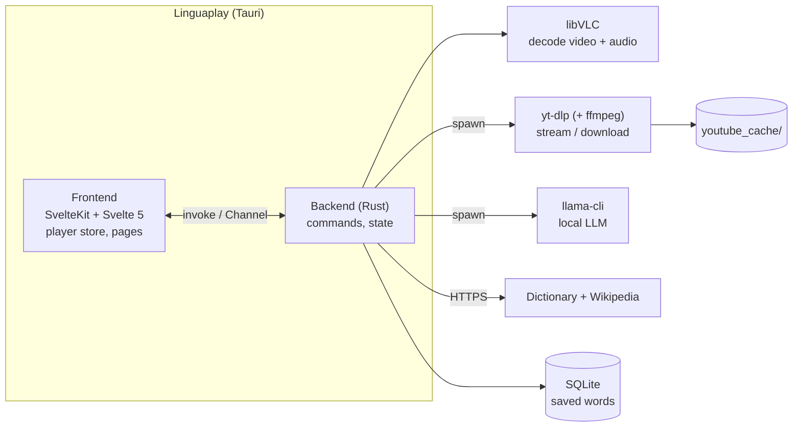

# Linguaplay

**Learn a language from the videos you already want to watch.** Open a local
video or a YouTube link, watch with subtitles, and tap any word you don't
know. Linguaplay pauses, explains it, and keeps it for spaced-repetition
review.



## Features

- **Tap any subtitle word.** The video pauses on the word and shows its
  dictionary entry (phonetics, audio, meanings) from the Free Dictionary API,
  with a Wikipedia summary as a fallback.
- **Local files and YouTube.** MP4/MKV and friends play through libVLC, including
  subtitle tracks embedded in MKV files and sidecar `.srt`/`.vtt` files.
  YouTube links stream through `yt-dlp`, or are downloaded when YouTube blocks
  streaming.
- **Transcript beside the video.** Every line with a timestamp; click one to
  jump there. Loop a line, go back a line, or pause after every line.
- **Your words.** Save words with the sentence and the moment they came from,
  then review them with an SM-2 spaced-repetition session.
- **Optional on-device AI.** Install a small local model (llama.cpp + Qwen2.5)
  from inside the app for "Explain in context" and "More examples". Nothing
  is sent to a cloud LLM.
- **Readable subtitles on any scene.** Text and background colours, weight,
  size, font, outline, position and one-tap presets, with a live preview.
- **YouTube downloads you control.** Pick a download quality (up to 1080p), see
  live progress, and manage or clear downloaded videos from the Library with
  their disk usage.
- **16 themes**, light or dark. The player itself always stays dark.

### Tap a word, see what it means



### Follow along with the transcript



### Make subtitles readable on any scene

White text over a white page is hard to read. The style panel has colours,
backgrounds, outline, weight, position and presets such as *High contrast*,
and shows a preview over both a light and a dark background.



### Manage downloaded videos



## How it works

Linguaplay is a [Tauri 2](https://tauri.app) desktop app: a SvelteKit
(Svelte 5) frontend in the system WebView, talking to a Rust backend.



The video is not a native `<video>` element. libVLC decodes off-screen into a
buffer, each frame is JPEG-encoded in Rust and streamed to a `<canvas>` over a
Tauri `Channel`, and the frontend drops any frame that arrives while the
previous one is still decoding. Subtitles are parsed in Rust and drawn as HTML
over the canvas, which is what makes every word clickable.

For the full picture (frontend and backend module maps, the frame pipeline,
the YouTube stream / download / embed decision, the download cache and
progress channel, word lookup, spaced repetition, local LLM provisioning,
theming and storage), see **[ARCHITECTURE.md](ARCHITECTURE.md)**.

## Getting started

Windows is the platform this is developed and tested on.

### Prerequisites

| Tool | Why |
|---|---|
| [Node.js](https://nodejs.org) (current LTS) and npm | frontend build |
| [Rust](https://rustup.rs) (stable) and the MSVC build tools | Tauri backend |
| [VLC](https://www.videolan.org/vlc/) (64-bit) | provides `libvlc.dll`; `build.rs` looks in `C:\Program Files\VideoLAN\VLC`, or set `VLC_DIR` |
| [`yt-dlp`](https://github.com/yt-dlp/yt-dlp) on your `PATH` | YouTube streaming, captions and downloads |
| [`ffmpeg`](https://ffmpeg.org) on your `PATH` | merges video and audio when downloading |

### Run it

```bash
npm install
npm run tauri dev
```

The first Rust build takes a while; later ones are quicker. If a port-1420
error appears, something else (for example a Vite server inside WSL) is
holding it; stop that first.

### Check and test

```bash
npx svelte-check --tsconfig ./tsconfig.json   # frontend types
cd src-tauri && cargo test                    # backend unit tests
```

One backend test performs a real YouTube download and is marked `#[ignore]`;
run it with `cargo test download_ -- --include-ignored` when you have network
access.

## Project layout

```
src/
  routes/           player (/), library, vocabulary pages
  lib/              player.svelte.ts (the playback/YouTube/LLM store),
                    SubtitleStylePanel, AppHeader, recents, themes
src-tauri/
  src/lib.rs        app state, Tauri commands, libVLC frame pipeline
  src/youtube.rs    yt-dlp wrapper: streams, captions, cached downloads
  src/subtitles.rs  SRT/VTT parsing        src/mkv_subtitles.rs  MKV tracks
  src/vocabulary.rs SQLite + SM-2          src/dictionary.rs     word lookup
  src/llm.rs        local llama.cpp provisioning and prompts
branding/           app icon source (SVG)
docs/screenshots/   screenshots used above
```

## Notes

- YouTube changes often. If streaming or downloads start failing, update
  `yt-dlp` first (`yt-dlp -U`).
- Downloaded videos live in the app data directory under `youtube_cache/` and
  are capped at 3 GB (oldest removed first).
- The app identifier is still `com.videolearn.app` (and the browser-storage
  keys start with `videoLearn`), from before the rename. They decide where
  saved words, downloads, models and settings live, so changing them would
  make existing data appear to vanish.
- `Cargo.toml` turns incremental compilation off for dev builds, because the
  mixed optimisation levels intermittently failed to link with incremental on.

## License

MIT, as declared in `package.json`.
